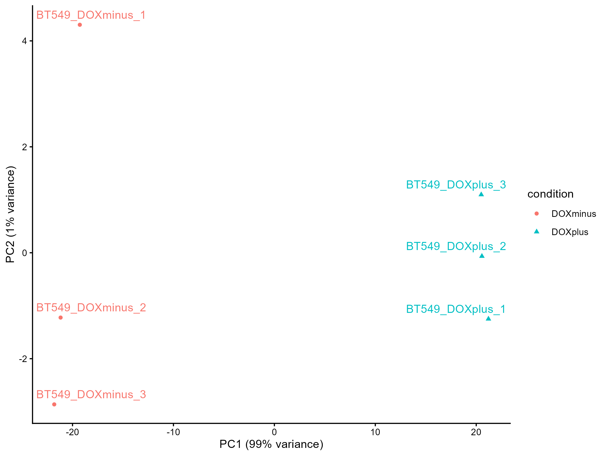
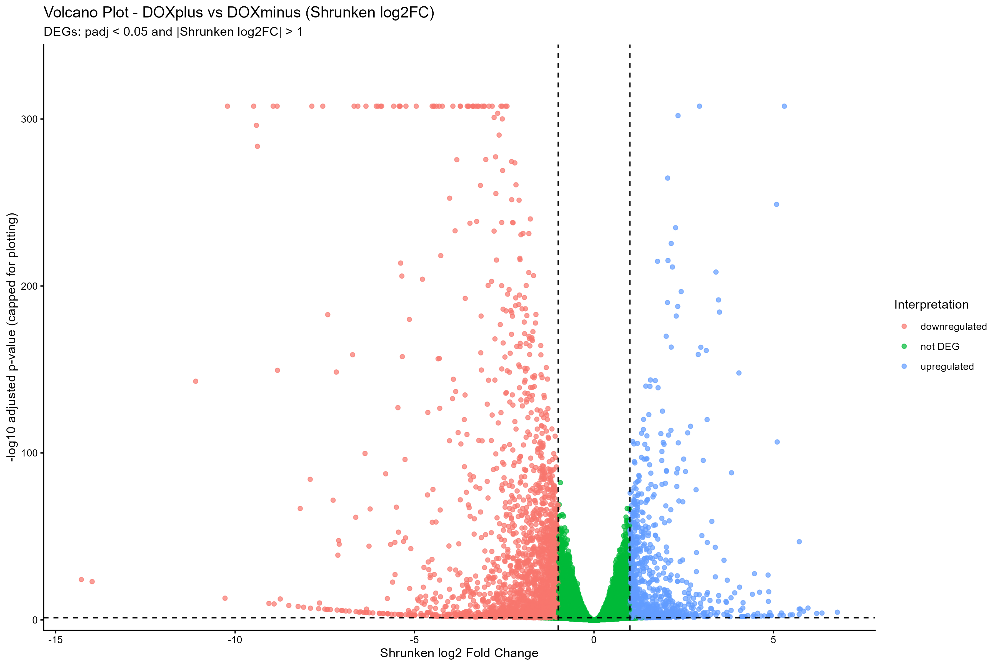
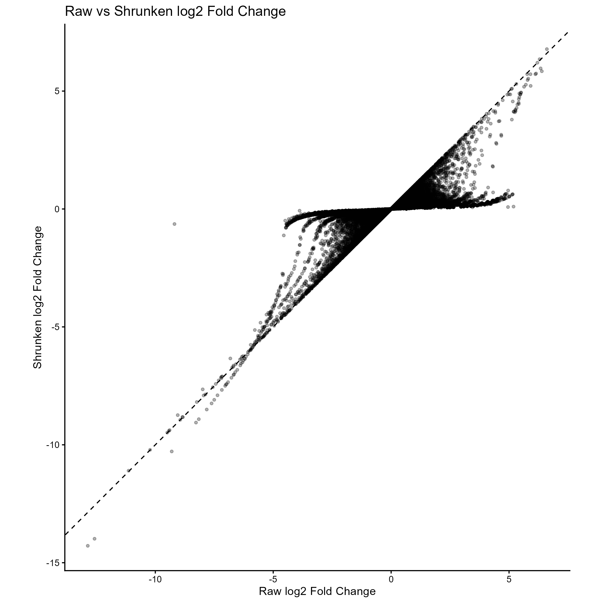
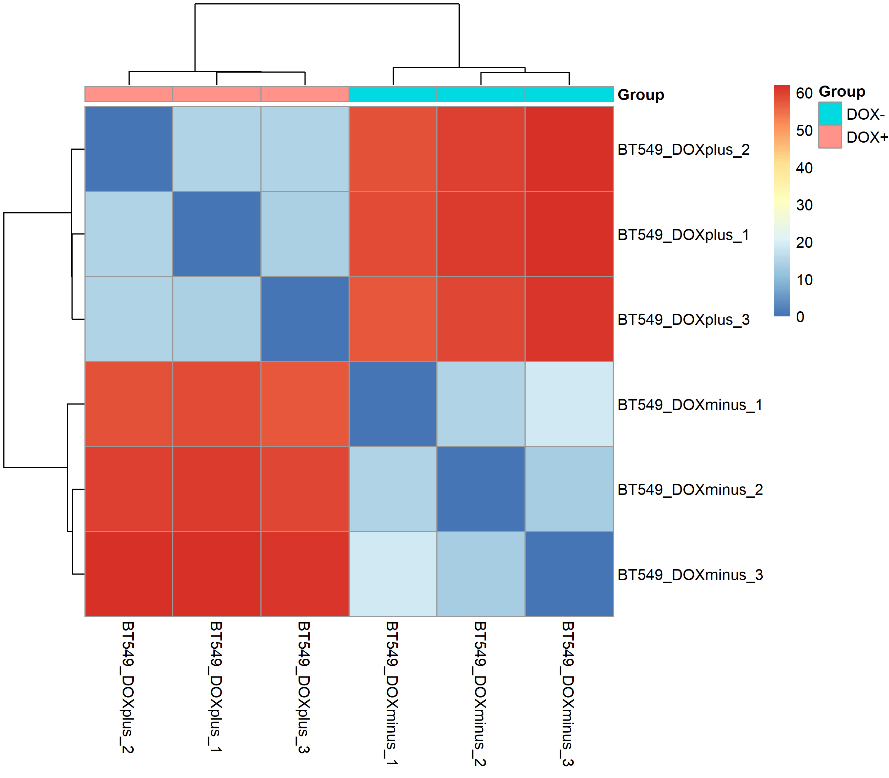
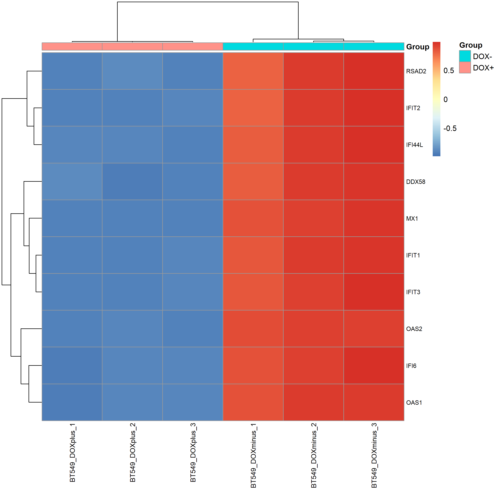
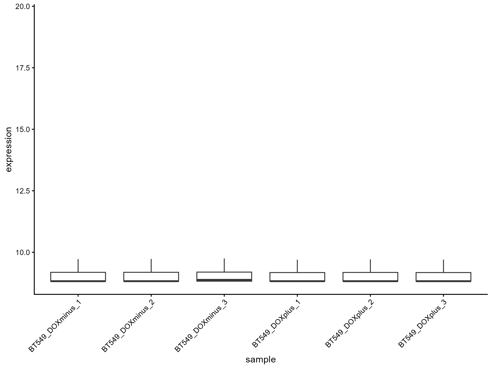

# RNA-seq Differential Expression Analysis of GSE164141

## Project Overview

This project investigates gene expression changes associated with inducible MUC1-C silencing in BT-549 triple-negative breast cancer cells.

The publicly available RNA-seq dataset GSE164141 was used to compare DOXplus (MUC1-C silencing induction) and DOXminus (control) conditions.

Differential gene expression analysis was performed using DESeq2 in R, with both unshrunken and apeglm-shrunken log2 fold-change estimates evaluated, as well as quality control and data visualization.

## Dataset

The dataset used in this project is GEO accession GSE164141 and consists of 6 RNA-seq samples from BT-549 triple-negative breast cancer cells: three control samples and three samples with doxycycline-induced MUC1-C silencing. A gene-level raw count matrix was used for the analysis.  

## Analysis Workflow

1.	Raw count data import
2.	Sample metadata preparation and validation
3.	Differential expression analysis using DESeq2
4.	Log2 fold-change shrinkage using apeglm
5.	DEG identification and classification using unshrunken and shrunken log2FC estimates separately
6.	Quality control and exploratory analysis using variance-stabilized expression data
7.	Data visualization and result export

## Methods and Thresholds

- Control DOXminus samples were used as the reference condition, and differential expression was evaluated as DOXplus versus DOXminus.
- Log2 fold-change estimates were shrunk using the apeglm method.
- Differential expression analysis was performed with DESeq2 using an alpha level of 0.05.
- Genes were classified as differentially expressed using an adjusted p-value threshold of padj < 0.05 and an absolute log2 fold-change threshold of |log2FC| > 1. The fold-change criterion was applied separately to unshrunken and apeglm-shrunken estimates.
- Variance-stabilized expression data were used for PCA, sample-distance analysis, and expression-based quality control.

## Key Results

- A total of 3422 genes when using unshrunken log2FC estimates met the differential expression criteria, including 1122 upregulated and 2300 downregulated genes.
- PCA of variance-stabilized expression data showed clear separation between DOXplus and DOXminus samples, with PC1 explaining approximately 99% of the variance and PC2 approximately 1%.
- Within the DOXminus group, BT549_DOXminus_1 showed a greater separation along PC2 compared with the other replicates. However, PC2 explained only approximately 1% of the total variance, and the cause of this separation could not be determined from PCA alone.
- Sample-to-sample distance analysis showed that samples clustered according to their experimental conditions.
- The 10 most variable genes showed distinct expression patterns between conditions and included several interferon-response-associated genes, such as MX1, IFIT1, IFIT2, and RSAD2, with higher expression in DOXminus samples.
- Applying the same DEG thresholds to apeglm-shrunken log2FC estimates identified 3,146 genes (980 upregulated and 2,166 downregulated), compared with 3,422 genes identified using unshrunken estimates. This difference reflects the influence of shrinkage on estimated effect sizes and threshold-based DEG classification.
- The comparison of unshrunken and apeglm-shrunken log2FC estimates showed that many fold-change estimates were shifted toward zero after shrinkage, while others remained close to the identity line. This illustrates the effect of shrinkage on estimated effect sizes and helps explain the difference in DEG counts between the two classifications.

## Figures

### Principal Component Analysis



### Volcano Plot




### Raw vs Shrunken log2FC Comparison



### Sample-to-Sample Distance



### Top 10 Most Variable Genes



### Expression Distribution



## Project Structure

```text
GSE164141/
├── data/
│   └── GSE164141_BT549_RawCounts_Matrix.csv.gz
├── script/
│   └── script.R
├── figures/
│   ├── PCA_all_conditions.png
│   ├── sample_distance_heatmap.png
│   ├── expression_distribution_boxplot.png
│   ├── top10_variable_genes_heatmap_v2.png
│   ├── volcano_plot.png
│   ├── shrunk_volcano_plot.png
│   └── raw_vs_shrunk_log2FC.png
├── results/
│   ├── DESeq2_all_results.csv
│   ├── DESeq2_shrunk_results.csv
│   ├── DESeq2_shrunk_vs_raw_results.csv
│   ├── significant_DEGs.csv
│   ├── shrunk_significant_DEGs.csv
│   ├── DEG_counts.csv
│   ├── DEG_counts_shrunk.csv
│   ├── top10_upregulated_genes.csv
│   ├── top10_downregulated_genes.csv
│   ├── top10_shrunk_upregulated_genes.csv
│   ├── top10_shrunk_downregulated_genes.csv
│   └── sessionInfo.txt
└── README.md
```

## Installation

The analysis requires R and the following packages.

### CRAN packages:
```r
install.packages(c(
  "dplyr",
  "tibble",
  "tidyr",
  "ggplot2",
  "pheatmap",
  "ggrepel"))
```
### Bioconductor packages:
```r
install.packages("BiocManager")

BiocManager::install(c(
  "DESeq2",
  "apeglm"))
```


## Reproducibility

The analysis was performed in R using DESeq2, apeglm, dplyr, tibble, tidyr, ggplot2, pheatmap, and ggrepel.

To reproduce the analysis:

1.	Download or clone this repository.
2.	Install the required R packages as described in the Installation section.
3.	Open R with the repository's root directory as the working directory.
4.	Execute:
```r
setwd("script")
source("script.R")
```

The script reads the raw count matrix from ../data/ and saves figures and analysis results to ../figures/ and ../results/, respectively.
R and package version information is available in results/sessionInfo.txt.


## Data Source and References

Dataset: GSE164141 — NCBI Gene Expression Omnibus

Original research: Original publication available through PubMed Central

This project is an independent reanalysis of publicly available RNA-seq data. The original dataset and experimental work belong to the respective study authors.
 